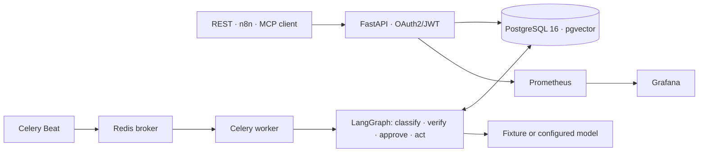

# verstak-agent

[Українська](README.uk.md)

Durable business workflow execution and an MCP control plane. A triage agent proposes an action from a request or uploaded document. An evidence agent checks its reference, amount, and currency against the submitted source and returns unsupported fields for correction. The reviewer approves or rejects the verified proposal. PostgreSQL retains the run, verification, approval decision, model spend, and LangGraph checkpoints. The approved action records a case in the same database.

## Run the demo

From the repository root on Linux or Docker Desktop in Linux-container mode, start the stack with Docker Compose v2.

```bash
git clone https://github.com/Galactic717/verstak-agent.git
cd verstak-agent
cp .env.example .env
docker compose up --build -d --wait
```

| Service | Local address |
| --- | --- |
| Swagger UI | <http://127.0.0.1:8000/docs> |
| MCP Streamable HTTP | <http://127.0.0.1:8001/mcp> |
| n8n | <http://127.0.0.1:5678> |
| Grafana | <http://127.0.0.1:3000> |
| Prometheus | <http://127.0.0.1:9090> |

The Compose profile uses labeled demo credentials and deterministic classification with no provider key. Use synthetic requests with this profile. The n8n exports cover webhook triage and review, Excel-to-Google-Sheets, and a scheduled evaluation digest. Their import and credential setup are documented separately. [n8n workflows](n8n_workflows/README.md)

[Watch the 45-second demo](docs/DEMO.gif)

To run the same workflow on local Qwen3-4B via Ollama, include the model overlay. The first start downloads the model into a named volume.

```bash
docker compose -f docker-compose.yml -f compose.ollama.yml up --build -d
```

### Submit and approve a run

These Bash commands use `curl` and `jq`.

```bash
API=http://127.0.0.1:8000
TOKEN=$(curl -fsS "$API/oauth/token" \
  -d grant_type=client_credentials -d client_id=demo \
  -d client_secret=verstak-demo-secret | jq -r .access_token)
AUTH="Authorization: Bearer $TOKEN"
RUN=$(curl -fsS "$API/workflows/triage/runs" -H "$AUTH" \
  -H 'Content-Type: application/json' -H "Idempotency-Key: demo-$(date +%s)" \
  -d '{"text":"Review invoice INV-1042 for USD 120.00"}' | jq -r .id)

curl -fsS "$API/runs/$RUN" -H "$AUTH" | jq
```

Poll the run until `waiting_approval`, review `triage` and `verification`, then submit a decision. Poll again to see `succeeded` or `rejected`.

```bash
curl -fsS "$API/approvals/$RUN" -H "$AUTH" \
  -H 'Content-Type: application/json' -d '{"approved":true}' | jq
curl -fsS "$API/runs/$RUN" -H "$AUTH" | jq
```

Use `POST /documents` with multipart field `file` for PDF, CSV, XLSX, or plain text. Pass the returned `id` as `document_id` when submitting a run. `GET /knowledge/search?q=...` searches the authenticated tenant's indexed chunks. An importable [Postman collection](docs/postman_collection.json) includes the request sequence.

### Connect an MCP client

For Streamable HTTP, set the server URL to `http://127.0.0.1:8001/mcp` and send the bearer token. For stdio, install Python 3.12 and `uv`, then configure the client to launch the following from this repository.

```bash
VERSTAK_MCP_API_TOKEN="$TOKEN" uv run --locked verstak-mcp --transport stdio
```

Tools search knowledge, read run status, and submit idempotent triage requests. The FastAPI service checks the forwarded token for every tool request. Approval uses its own API scope.

## Execution model



- The run row also acts as a durable dispatch record. Beat wakes a dispatcher that leases due rows and sends work to Redis. Stale leases make interrupted work eligible for delivery again.
- A per-run PostgreSQL advisory lock serializes workers. The graph pauses before the business action and resumes using the same checkpoint thread. A unique key on the case action protects the PostgreSQL effect during replay.
- Pydantic validates the model's tool proposal. The worker reserves spend in integer USD millionths before each model attempt. Each run permits at most three attempts, including corrections.
- The verification node checks the proposal's reference and matched amount/currency pair against the request or attached document. It persists its decision separately and asks the triage agent to repair unsupported fields within the same attempt and cost limits.
- Document retrieval fuses PostgreSQL BM25 and pgvector HNSW rankings. The bundled vectorizer uses deterministic lexical features, which keeps the demo reproducible.

[Architecture, failure modes, and threat model](docs/ARCHITECTURE.md)

[OpenTelemetry and the local Jaeger profile](docs/TRACING.md) · [Optional Render deployment blueprint](docs/DEPLOYMENT.md)

## Verification and evaluation

```bash
uv sync --locked
uv run ruff check .
uv run ruff format --check .
uv run mypy --strict src
uv run pytest tests/unit
docker compose exec -T api verstak-eval
```

The same evaluator accepts a configured OpenAI-compatible, Anthropic, or Gemini endpoint, including a local vLLM or Ollama server via its compatible API. See the 30-case corpus, model configuration, metric definitions, and report upload. [Evaluation guide](evals/README.md)

| Measured with the bundled fixture | Result |
| --- | ---: |
| Golden cases | 30 |
| Tool-call F1 | 0.9333 |
| Schema validity | 100% |
| Grounded field accuracy | 96.67% |
| p95 classification latency in the local Linux container | 0.0224 ms |
| Estimated model cost per 1,000 classifications | $0.00 |

Fixture results measure classification only. Use the emitted report for p95 latency on your machine. The benchmark guide includes local Qwen runs using the same golden cases.

Local verification passed 78 Python tests at 87.13% line coverage, two Playwright scenarios, and a Jaeger trace smoke test against the Linux Compose stack. All 10 injected post-action failures recovered with one case action per run. All 10 injected evidence errors reached human review after a single correction using the fixture provider. A separate live smoke test killed the worker while approval was pending, then resumed the run with one model attempt and one case action. GitHub Actions runs the integration, failure-injection, Gherkin, browser, and trace suites.
